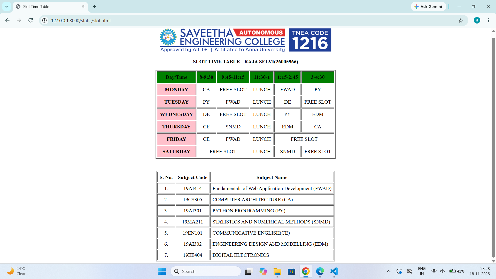

# Ex04 Time Table
## Date:17/11/2026

## AIM
To write a html webpage page to display your slot timetable.

## ALGORITHM
### STEP 1
Create a Django-admin Interface.

### STEP 2
Create an App inside the Django project.

### STEP 2
Create a static folder uder the created App and insert HTML code.

### STEP 3
Create a simple table using ```<table>``` tag in html with the relevant attributes.

### STEP 4
Add rows using ```<tr>``` tag.

### STEP 5
Add your course schedule using ```<td>``` tag.

### STEP 6
Execute the program using runserver command.

## PROGRAM
```
<html>
<head>
    <title>Slot Time Table</title>
</head>
<body>

    <center>
        
        <p><b>SLOT TIME TABLE - RAJA SELVI(26005966)</b></p>
        <table border="3" cellspacing="3" cellpadding="8" bgcolor="white">
            <tr bgcolor="green">
                <th>Day/Time</th>
                <th>8-9:30</th>
                <th>9:45-11:15</th>
                <th>11:30-1</th>
                <th>1:15-2:45</th>
                <th>3-4:30</th>
            </tr>
            <tr align="center">
                <th bgcolor="pink">MONDAY</th>
                <td>CA</td>
                <td>FREE SLOT</td>
                <td>LUNCH</td>
                <td>FWAD</td>
                <td>PY</td>
            </tr>
            <tr align="center">
                <th bgcolor="pink">TUESDAY</th>
                <td>PY</td>
                <td>FWAD</td>
                <td>LUNCH</td>
                <td>DE</td>
                <td>FREE SLOT</td>
            </tr>
            <tr align="center">
                <th bgcolor="pink">WEDNESDAY</th>
                <td>DE</td>
                <td>FREE SLOT</td>
                <td>LUNCH</td>
                <td>PY</td>
                <td>EDM</td>
            </tr>
            <tr align="center">
                <th bgcolor="pink">THURSDAY</th>
                <td>CE</td>
                <td>SNMD</td>
                <td>LUNCH</td>
                <td>EDM</td>
                <td>CA</td>
            </tr>
            <tr align="center">
                <th bgcolor="pink">FRIDAY</th>
                <td>CE</td>
                <td>FWAD</td>
                <td>LUNCH</td>
                <td colspan="2">FREE SLOT</td>
            </tr>
             <tr align="center">
                <th bgcolor="pink">SATURDAY</th>
                <td colspan="2">FREE SLOT</td>
                <td>LUNCH</td>
                <td>SNMD</td>
                <td>FREE SLOT</td>
            </tr>
        </table>

        <br><br>

        <table border="2" cellspacing="3" cellpadding="6">
            <tr>
                <th>S. No.</th>
                <th>Subject Code</th>
                <th>Subject Name</th>
            </tr>
            <tr>
                <td align="center">1.</td>
                <td align="center">19AI414</td>
                <td>Fundamentals of Web Application Development (FWAD)</td>
            </tr>
            <tr>
                <td align="center">2.</td>
                <td align="center">19CS305</td>
                <td>COMPUTER ARCHITECTURE (CA)</td>
            </tr>
            <tr>
                <td align="center">3.</td>
                <td align="center">19AI301</td>
                <td>PYTHON PROGRAMMING (PY)</td>
            </tr>
            <tr>
                <td align="center">4.</td>
                <td align="center">19MA211</td>
                <td>STATISTICS AND NUMERICAL METHODS (SNMD)</td>
            </tr>
            <tr>
                <td align="center">5.</td>
                <td align="center">19EN101</td>
                <td>COMMUNICATIVE ENGLISH(CE)</td>
            </tr>
            <tr>
                <td align="center">6.</td>
                <td align="center">19AI302</td>
                <td>ENGINEERING DESIGN AND MODELLING (EDM)</td>
            </tr>
            <tr>
                <td align="center">7.</td>
                <td align="center">19EE404</td>
                <td>DIGITAL ELECTRONICS</td>
            </tr>
        </table>
    </center>

</body>
</html>

```

## OUTPUT


## RESULT
The program for creating slot timetable using basic HTML tags is executed successfully.
